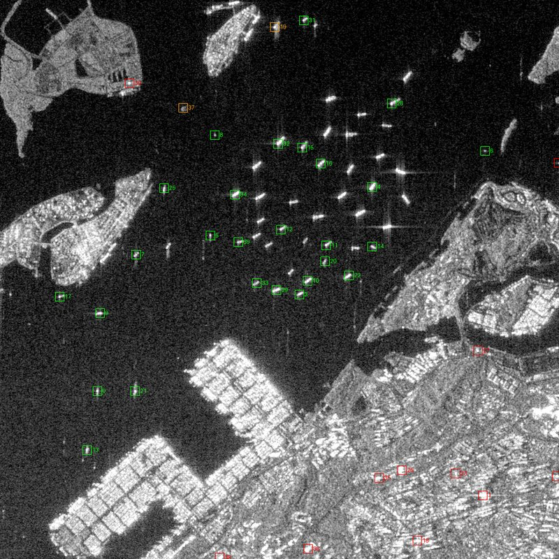

# Avis de l'IA sur les cibles radar

<p class="where">Fiche d'une cible (carte ou incident) → bloc <strong>Avis xView3</strong> · Incident → <strong>Pourquoi cette alerte ?</strong> · Administration → <strong>Supervision</strong> → <em>Avis IA</em> · <code>GET /api/v1/system/ai</code>.</p>

La détection radar de KRAKEN est **physique** : un écho plus brillant que la mer environnante (CFAR), puis un indice de fiabilité explicable. Un modèle d'IA peut y ajouter **un avis chiffré**, affiché à côté des mesures. **L'IA ne prend aucune décision** : elle ne crée pas de cible, n'en supprime pas, ne modifie ni la fiabilité, ni le score de risque, ni la priorité d'un incident. C'est l'opérateur qui juge.

## xView3 : le modèle recommandé

| Élément | Valeur |
| --- | --- |
| Origine | Solution **classée 1re** du concours [xView3-SAR](https://iuu.xview.us/) (Global Fishing Watch, Defense Innovation Unit, 2021-2022), consacré à la détection des navires « sombres » sur Sentinel-1 |
| Auteur, licence | Eugene Khvedchenya, **MIT** ([dépôt](https://github.com/BloodAxe/xView3-The-First-Place-Solution)) : usage, modification et redistribution libres, y compris commerciaux |
| Modèle | CircleNet, U-Net à encodeur EfficientNet-B4 (pli 0 de l'ensemble primé), 79 Mo, exécuté sur processeur |
| Entrée | Les **deux polarisations** VH et VV de la scène, en dB, autour de chaque cible (2,56 × 2,56 km) |
| Intégrité | Téléchargé au premier démarrage, **empreinte SHA-256 vérifiée** avant tout chargement ; un fichier différent n'est jamais ouvert |
| Coût | ≈ 0,1 s par cible (2 cœurs) ; ≈ 2 Go d'image Docker |

### Ce que l'opérateur voit

Pour chaque cible radar, quatre valeurs lues par le modèle **à l'endroit de la cible** :

| Valeur | Question à laquelle le modèle répond |
| --- | --- |
| **Objet maritime présent** | Y a-t-il réellement quelque chose ici (navire ou structure), ou seulement du fouillis de mer ? |
| **Si objet : navire** | Est-ce un navire, plutôt qu'une structure fixe (plateforme, bouée, rocher, éolienne) ? |
| **Si navire : en pêche** | Est-ce un navire de pêche en activité ? |
| **Longueur estimée** | Longueur du navire selon le modèle, à comparer à la mesure de l'écho |

Les deux valeurs « navire » et « pêche » n'ont de sens que si un objet est vu : en dessous de 30 % d'« objet », elles ne sont pas affichées. Ces valeurs sont :

- affichées dans la fiche de la cible (bloc **Avis xView3 (information, sans effet sur l'alerte)**) ;
- reprises en ligne d'information dans **Pourquoi cette alerte ?** (icône ⓘ, jamais une condition de l'alerte) ;
- **scellées dans la preuve C2PA** (assertion `xview3_opinion` : modèle, empreinte, calibration, avis par cible), donc vérifiables a posteriori.

### Validation sur une scène réelle

Essai réalisé lors de l'intégration, sur une vraie scène Sentinel-1 du **21 octobre 2026** (détroit de Singapour, mouillage dense), avec la chaîne KRAKEN complète : détection CFAR, puis avis xView3 sur les 40 cibles les plus contrastées.



*Vert : objet ≥ 50 % · orange : 20 à 50 % · rouge : < 20 %. Contient des données Copernicus Sentinel modifiées (2026).*

| Cibles CFAR | Avis xView3 |
| --- | --- |
| Navires au mouillage (29) | objet **56 à 78 %**, navire **80 à 93 %** pour la plupart, longueurs de 40 à 120 m cohérentes |
| Échos sur la terre ferme : bâtiments, grues (9) | objet **0 à 2 %** : tous écartés |
| Cas ambigus (2) | 30 à 40 % |

Sur la Guyane (scène du 19 octobre 2026), les cibles faibles du CFAR (contraste 5 à 10, échos de 2 à 3 pixels proches du bruit) ont toutes reçu un avis « objet » de 1 à 20 % : un indice utile pour prioriser la vérification. Comme pour tout modèle, l'avis reste à confronter aux autres éléments (AIS, imagerie, historique).

### Activer

```bash
make up-ai     # démarre la plateforme + le service xview3 et le branche (XVIEW3_URL)
make up        # revenir sans IA
```

Le service ne reçoit que des **découpes radar** (aucun identifiant, aucune donnée AIS) et ne sort pas du réseau interne Docker. S'il est arrêté, en cours de chargement ou en erreur, le scan se déroule normalement, sans avis ; l'échec est visible dans **Supervision** (colonne *Avis xView3* des scans, état du service).

### Calibration (approximation documentée)

Les pixels GRD sont des amplitudes numériques (DN). Le modèle attend une rétrodiffusion calibrée en dB : KRAKEN calcule `20·log10(DN)` puis aligne, **tuile par tuile**, la médiane de la mer sur celle des scènes d'entraînement xView3 (VH −26,3 dB, VV −16,4 dB). C'est une approximation de la calibration radiométrique, suffisante pour un modèle qui raisonne sur le contraste ; elle est inscrite dans la preuve.

## Mesurer l'avis contre les opérateurs

Administration → **Supervision** → *Avis IA* et `GET /api/v1/system/ai` comparent chaque avis (« objet » ≥ 50 % pour xView3) aux incidents clos :

| Verdict de l'opérateur | IA « oui » | IA « non » |
| --- | --- | --- |
| Pêche INN confirmée / activité légitime | vrai positif | faux négatif |
| Fausse alarme | faux positif | vrai négatif |

On obtient la **précision**, le **rappel** et l'**accord** global, jugés indicatifs sous 30 incidents. Ces mesures servent à savoir **quelle confiance accorder à l'avis** sur vos propres données ; elles ne déclenchent rien.

## Ancien détecteur YOLOv8n (déconseillé)

Un premier modèle (Hugging Face `MeWan2808/yolov8n-sar-vessel-detection`, ONNX 12 Mo) reste disponible via **Administration → Paramètres → `ai_detector_mode`** :

| `ai_detector_mode` | Effet |
| --- | --- |
| **0 — arrêt** (défaut) | Aucun appel |
| **1 — observation** | Confiance affichée et scellée, sans effet |
| **2 — actif** | Agit sur la fiabilité (+0,10 / −0,10) et peut créer des cibles « détectées par l'IA seule » |

Il est **déconseillé** : en essai, il ne dépasse pas 0,30 de confiance sur des navires de 90 à 250 m à 10 m de résolution, et la licence du fichier (AGPL-3.0 Ultralytics dans ses métadonnées, MIT sur la fiche) est à clarifier. Le mode 2 est le seul cas où une IA pèse sur une alerte : laissez-le à 0, xView3 le remplace en information seule.

## Imagerie optique

Aucun modèle optique n'est branché : le seul modèle Sentinel-2 dédié trouvé sur Hugging Face (`ArturWoz/ship-detection-sentinel2`) n'a **pas de licence**, donc aucun droit d'usage. L'imagerie Sentinel-2 à 10 m est affichée sur la carte pour la vérification visuelle par l'opérateur.
